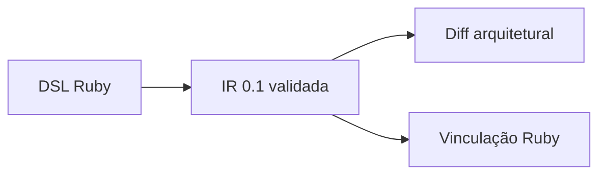

<p align="center">
  <picture>
    <source media="(prefers-color-scheme: dark)" srcset="logo/vetra-logo-dark.svg">
    
  </picture>
</p>

<p align="center">
  Aplicações Ruby descritas como um grafo verificável.
</p>

O **Vetra** é um framework web em desenvolvimento para **Ruby 4 e PostgreSQL**. Entidades, comandos,
consultas, permissões e eventos formam um modelo explícito da aplicação: o **Grafo da Aplicação**.

Esse modelo permite conferir contratos, dependências e regras declarativas, identificar inconsistências
e revisar mudanças de arquitetura junto com o código.

> **Estado atual: protótipo da fase 0.** O repositório entrega um compilador experimental, ferramentas de
> validação, diff e vinculação de implementações. A execução dos comandos de negócio, o servidor web e a
> persistência ainda não existem. Veja a [situação do projeto](docs/situacao-do-projeto.md) para acompanhar
> entregas, pendências e evidências.

## O que já funciona

O compilador transforma declarações Ruby em uma **representação intermediária (IR) versionada**, gravada em
`.vetra/graph.json`. O artefato usa JSON canônico, inclui hashes dos fontes e faz parte da revisão no Git.



| Área | Disponível no protótipo |
|---|---|
| Modelo de dados | Entidades, tipos, `money` com escala por moeda, relações, índices e chaves compostas por tenant |
| Operações | Contratos CRUD, comandos, consultas, eventos e handlers representados no grafo |
| Autorização declarativa | Papéis e políticas com escopo por autor, dono ou vínculo, com validação das referências e dependências |
| Exposições | Declarações de HTTP, CLI, job e webhook, com conferência de rotas, destinos e idempotência exigida |
| Revisão | Diff de contratos, permissões, capacidades, privacidade, transições e metadados |
| Vinculação | Conferência do artefato, dos fontes e dos blocos Ruby, sem executar operações |

O [guia da fase 0](docs/fase-0.md) detalha o DSL suportado e o alcance da análise estática dos blocos Ruby.

## Experimente o compilador

Use **Ruby 4.0.9**, conforme [.ruby-version](.ruby-version), e Bundler. A compilação dos exemplos e a suíte
do compilador funcionam sem um banco de dados. As sondas de PostgreSQL têm requisitos próprios, descritos nos
[ADRs](docs/adr/README.md#sondas).

Na raiz do repositório:

```sh
bundle install
bundle exec bin/vetra graph:build --root examples/blog
bundle exec bin/vetra graph:check --root examples/blog
bundle exec bin/vetra graph:validate --root examples/blog --sources
bundle exec bin/vetra graph:link --root examples/blog
```

O build grava [examples/blog/.vetra/graph.json](examples/blog/.vetra/graph.json). O check compara esse
arquivo com os fontes; o link confere o pacote e associa as implementações aos blocos declarados. Essas
etapas não iniciam um servidor nem executam o comando `publish_post`.

Para comparar o grafo atual com o que está no último commit:

```sh
bundle exec bin/vetra graph:diff git:HEAD examples/blog/.vetra/graph.json --root examples/blog
```

| Comando | Finalidade |
|---|---|
| `graph:build` | Compilar, validar e gravar o grafo |
| `graph:check` | Detectar artefato ausente, editado ou desatualizado, sem regravá-lo |
| `graph:validate` | Validar uma IR; com `--sources`, também conferir o manifesto e os hashes dos fontes |
| `graph:diff` | Comparar arquivos ou revisões Git e destacar mudanças que exigem revisão |
| `graph:link` | Vincular o código ao artefato validado e verificar sua correspondência |

## Um comando em Ruby

Este é o comando de publicação do [exemplo de blog](examples/blog). Sua entidade e suas políticas estão em
[post.rb](examples/blog/app/domains/blog/post.rb) e [roles.rb](examples/blog/app/domains/blog/roles.rb).

```ruby
# app/domains/blog/publish_post.rb
command :publish_post do
  input :post_id, :id
  returns :post
  authorize :update, :post, record: :post_id
  uses :posts, :clock
  emits "blog.post.published", with: %i[id]

  call do |input, posts, clock|
    post = posts.lock!(input.post_id)
    fail! :status, "só rascunhos podem ser publicados" unless post.status == "draft"
    posts.update!(post, status: "published", published_at: clock.now)
  end

  expose http: "POST /posts/:post_id/publish"
end
```

`uses` declara as capacidades recebidas pelo bloco. `returns` identifica o contrato de saída; `authorize`
registra a ação e o registro a autorizar; `emits` declara o evento. A exposição HTTP aponta para essa mesma
operação. O compilador registra e verifica essas relações; a execução depende do futuro motor de operações.

## Exemplos disponíveis

| Diretório | O que demonstra hoje |
|---|---|
| [examples/blog](examples/blog) | Aplicação sem tenant, escopo do autor, publicação e campos protegidos |
| [examples/mini_crm](examples/mini_crm) | Tenant, `money`, transição, evento, handler e quatro superfícies de exposição |
| [examples/mini_crm_revendas](examples/mini_crm_revendas) | Revendas, vendedores e papéis com escopo por vínculo |
| [examples/chat](examples/chat) | Salas, relação muitos-para-muitos e comandos explícitos de inclusão e remoção de membros |

Os diretórios contêm recortes compiláveis da fase 0. Autenticação, telas, persistência e entrega em tempo
real continuam pendentes. Troque `--root examples/blog` pelo diretório desejado para inspecionar outro exemplo.

As árvores **“Estrutura em Vetra”** dos PDFs descrevem a organização prevista para as aplicações, com pastas
resumidas e alguns componentes gerados omitidos. Elas incluem funcionalidades futuras; o conteúdo disponível
para compilar hoje está nos diretórios acima.

## Direção do projeto

A base definida nos ADRs reúne quatro componentes:

1. **Grafo da Aplicação:** modelo compilado e versionado, implementado parcialmente nesta fase.
2. **Motor de operações:** comandos e consultas com contratos, autorização e adaptadores para cada superfície.
3. **Motor de autorização:** execução das políticas e dos escopos declarados no grafo.
4. **Vetra Data:** persistência com Sequel e PostgreSQL, isolamento de linhas (RLS) e contexto assinado.

Sobre essa base, o projeto prevê consultas reativas, workflows duráveis, recursos de privacidade e auditoria,
UI e operações MCP com identidade delegada. A adoção planejada começa em aplicações Rails existentes, um
domínio por vez. A integração com Rails também está pendente. Ruby::Box e execução com Ractors são extensões
opcionais; o compilador atual funciona sem elas.

O próximo trabalho está detalhado na [situação do projeto](docs/situacao-do-projeto.md#7-próximos-passos-propostos).
A [matriz de aceitação da fase 0](docs/fase-0-criterios.md) registra as evidências e os critérios ainda parciais.

## Testes e contribuição

Execute a suíte completa com a verificação de cobertura dos códigos de diagnóstico:

```sh
bundle exec rake test:diagnostics
```

Essa também é a tarefa padrão de `bundle exec rake`. A [CI](.github/workflows/ci.yml) verifica os testes,
os artefatos dos exemplos, a vinculação e o diff arquitetural, além das sondas de banco no PostgreSQL 17 e 18.

Ao alterar o modelo de um exemplo, reconstrua seu grafo com `graph:build`, revise o `graph:diff` e inclua
o artefato atualizado na mudança. Acrescente casos de erro às novas regras e mantenha a documentação e a
situação do projeto coerentes com o código. O [guia da fase 0](docs/fase-0.md) explica o DSL suportado e os
limites da análise.

## Documentação

| Documento | Conteúdo |
|---|---|
| [Situação do projeto](docs/situacao-do-projeto.md) | Entregas, pendências e estado atual |
| [Guia da fase 0](docs/fase-0.md) | Execução, DSL implementado e limites do protótipo |
| [Critérios da fase 0](docs/fase-0-criterios.md) | Cobertura e evidências de aceitação |
| [Diff arquitetural](docs/graph-diff.md) | Contratos, permissões, referências Git e relatório JSON |
| [Vinculação de implementações](docs/graph-link.md) | Integridade do pacote, registro Ruby e dados compartilháveis |
| [IR 0.1](docs/ir/README.md) | Schema, exemplos documentais e compatibilidade |
| [Índice de ADRs](docs/adr/README.md) | Decisões de arquitetura, resoluções e status de cada proposta |

O [ADR-001](docs/adr/001-grafo-da-aplicacao-e-ir.md) define o contrato do grafo, e o
[ADR-016](docs/adr/016-ciclo-de-vida-da-operacao.md) define o ciclo de vida das operações.

Os PDFs preservam a proposta e suas revisões; os ADRs registram as decisões posteriores:

- [Proposta técnica](docs/proposta-tecnica.pdf).
- Comparações com Rails: [Mini CRM](docs/exemplos/01-mini-crm.pdf), [Blog](docs/exemplos/02-blog.pdf) e
  [Chat](docs/exemplos/03-chat.pdf).
- [Histórico de revisões](docs/revisoes.pdf) e [pendências da rodada 7](docs/pendencias-rodada-7.pdf).

## Mapa do repositório

| Caminho | Conteúdo |
|---|---|
| [bin/vetra](bin/vetra) | Entrada da CLI |
| [lib/vetra/](lib/vetra) | DSL, compilador, validador, diff e vinculação |
| [examples/](examples) | Modelos compiláveis e seus artefatos versionados |
| [test/](test) | Testes do compilador, da CLI e dos exemplos |
| [script/](script) | Sondas dos ADRs e simulação do gate da CI |
| [docs/](docs) | Guias, ADRs, schema e documentos da proposta |
| [logo/](logo) | Identidade visual |

## Licença

[MIT](LICENSE). A governança do projeto ainda está em aberto (veja as questões em aberto na proposta).
